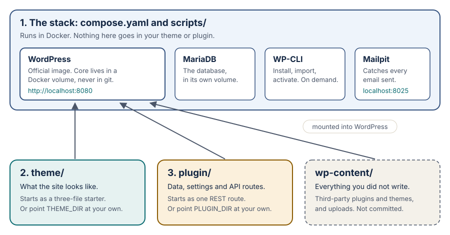

# WordPress Docker Stack

A local WordPress for building a theme and a plugin. One command starts it. It is for development on your own machine, not for production.



## The three parts

| Part | Folder | What it holds |
| --- | --- | --- |
| 1. The stack | `compose.yaml`, `scripts/` | WordPress (the official image), MariaDB, WP-CLI and Mailpit. WordPress core lives in a Docker volume and never goes in git. |
| 2. The theme | `theme/` | What the site looks like. It starts as a three-file starter theme. |
| 3. The plugin | `plugin/` | Data, settings and API routes. It starts as one REST route. |

`wp-content/` holds everything you did not write: third-party plugins and themes, and uploads. Git ignores what is in it.

## Start

You need Docker.

```sh
cp .env.example .env     # optional: every value has a default
bash scripts/setup.sh
```

- Site: <http://localhost:8080>
- Admin: <http://localhost:8080/wp-admin/>, **admin / password** (local only)
- Mail inbox: <http://localhost:8025>
- The plugin's route: <http://localhost:8080/wp-json/starter/v1/ping>

`setup.sh` installs WordPress, turns on pretty permalinks, and activates the starter theme and plugin. You can run it again: it does not reinstall or reset anything.

## Build your own theme and plugin

Edit `theme/` and `plugin/` in place. WordPress reads the files directly, so a change shows on the next page load.

If your code lives in its own repository, point the stack at it in `.env`:

```sh
THEME_DIR=../my-theme
THEME_SLUG=my-theme
PLUGIN_DIR=../my-plugin
PLUGIN_SLUG=my-plugin
```

The slug is the folder name WordPress sees. To mount more than one theme or plugin, copy `compose.override.example.yaml` to `compose.override.yaml`.

## Copy an existing site

To run a copy of a site that already exists, you need three things from it: a database dump, its `plugins` folder and its `uploads` folder.

1. Put the plugins in `wp-content/plugins/` and the uploads in `wp-content/uploads/`.
2. Set the versions in `.env` to match the site: `WORDPRESS_TAG` and `WP_CLI_TAG`, with the same PHP version in both. Do this before the first start. WordPress core is copied into a Docker volume once, so a new tag after that changes PHP but not WordPress. To change WordPress later, run `bash scripts/reset.sh DELETE` first.
3. Load the database:

```sh
bash scripts/import.sh path/to/dump.sql.gz
```

`import.sh` empties the local database, loads the dump, then rewrites the old site address to your local one. The site keeps the theme and plugins its database names, and its own admin users. If the dump uses a table prefix other than `wp_`, the script tells you which one to set.

⚠️ A database dump can hold personal data. Keep dumps in `dumps/` or in the repository root: git ignores `dumps/` and, in the root, `*.sql`, `*.sql.*`, `*.gz` and `*.zip`. Never commit one.

⚠️ A copied site can bring its own mail plugin and its live mail settings. A plugin that sends through a provider's own service does not pass through Mailpit, so it can reach real people. Before you test anything that sends mail, look at the active plugins and switch mail plugins off: `docker compose run --rm cli plugin deactivate <name>`.

## Commands

```sh
docker compose ps                              # what is running
docker compose logs --tail=50 wordpress        # WordPress and PHP errors
docker compose run --rm cli plugin list        # any WP-CLI command
mkdir -p dumps && docker compose run --rm -T cli db export - > dumps/local.sql
docker compose stop                            # stop, keep everything
bash scripts/reset.sh DELETE                   # delete the database and WordPress core
```

`reset.sh` leaves `theme/`, `plugin/` and `wp-content/` alone.

## Run two sites at once

Clone the repository twice, and give each copy its own name and ports in `.env`:

```sh
COMPOSE_PROJECT_NAME=second-site
WP_PORT=8081
MAIL_PORT=8026
```

## Email

Every email sent through WordPress's own mailer goes to Mailpit, not to a real inbox. `mu-plugins/local-mail.php` does this. A plugin that sends mail another way is not caught: see the warning under [Copy an existing site](#copy-an-existing-site).

## Known limits

- **Linux is not tested.** The stack was built and run on macOS. On Linux the containers write files as user 33, and your folders belong to you. If WordPress cannot write to `wp-content/`, run `sudo chown -R 33:33 wp-content`.
- **Scheduled tasks do not run on their own.** WordPress starts them by calling its own address, and inside the container nothing answers on `localhost:8080`. Run the due ones by hand: `docker compose run --rm cli cron event run --due-now`. Site Health shows a loopback error for the same reason.
- **WordPress writes into `wp-content/` on the first start:** its default themes and two plugins. If `WP_CONTENT_DIR` points at a folder someone gave you, it writes there too.
- **`.env` is read as a shell file** by the scripts. Put quotes around a value that has a space.

## Not for production

The ports listen on your own machine only, the passwords are fixed, and there is no HTTPS. Before 2026 this repository held an nginx, Let's Encrypt and MySQL 5.7 set-up for hosting; that version is in the git history.
